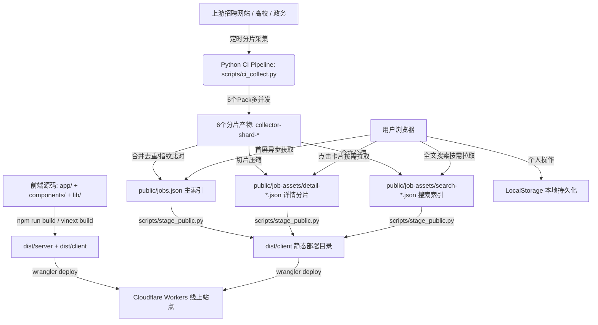

# 职讯雷达 (Job Radar) · AI 项目交接与上下文备忘录

> **适用对象**：后续接手本项目的任何 AI 助手（Claude, ChatGPT, Cursor, Copilot, Antigravity 等）或新开会话。  
> **使用方法**：接手本项目时，**优先通读本文档**，可直接掌握全部架构设计、数据流、踩坑规避点与验证命令，避免重复排查与设计偏离。

## 2026-10-26：多城市与求职工作台已在本地实施

用户已要求按详细计划实现并评估耗时。本地修改基于 `87edcf6`；结果、验证口径与未完成来源见 [实施结果](docs/implementation-results-20261026.md)。实施验证时尚未提交、推送或部署；用户随后明确要求“提交推送部署吧”，已授权提交、推送及正常采集部署与生产检查。具体发布结果须以随后记录的提交及运行状态为准，不能把已触发当成已成功。

统一城市注册表（2024版内地369个地级/直辖/省直管单元、2846县级对应），生成TS、Python同源读取；公共线索城市查询独立固定，扩UI字典不扩每轮请求。修复9场宣讲城市（淄博6/聊城2/潍坊1）、单位所在地污染岗位城市、旧岗位表地点补投影；完整原始ID、历史时间保留。新增覆盖哈希资产与来源缺口说明，两个官方云端日历源（南开、北大）有界实测成功。中石大/复旦日历认证、邮储空栏目、部分旧渠道陈旧仍有限制，未宣称全国完整覆盖。

新增多工作城市、独立活动城市/学校/日期/类型、活动收藏和ICS导出、资格按同岗位行联合筛选、保守招聘有效性、投递阶段/时间/备注及页面内提醒。旧本地键和v1/v2备份兼容，导出v3支持活动与设置，导入先验证/冲突预览/事务保存；不上传个人数据。后台推送/跨设备同步仍为后续服务。保留Claude界面；新增样式在 `app/feature-updates.css`，不要重新启用旧 `workspace.css`。

验证：Python3.12定向155项、前端定向72项，lint/tsc/build/字典生成检查通过。完整32,411条来源离线重导出20,823条合并索引，manifest/分片/历史及全部来源ID还原通过；零新增采集请求。本地同机3次完整导出中位38.884→32.228秒（快约17.1%，不是NAS总耗时），两新源首页面小窗口合计约6.6秒。NAS90秒/源、1200秒软预算，云端180秒/源、1080秒分片预算保持，依赖/镜像/代理未变。实际Edge隔离上下文验证桌面/390px手机、城市持久化、活动收藏、ICS下载、投递保存与备份恢复。真实日历应用导入、生产资产与完整NAS时间尚未验证。

`scripts/reproject_snapshot.py` 只向独立空目录回填；不能覆盖原输入/public或刷新官网核验时间。忽略目录 `data/implementation-20261026/` 有完整真实输入、报告和本地预览数据；不提交这些大文件。部署必须用当前代码重新合并/导出，`deploy_only` 复用旧数据不能证明地点修复。当前新增配置目录必须随代码提交；`scripts/generate_city_registry.py --check`已加入Push Checks。

## 2026-10-26：多城市审计实施计划（原始计划记录）

用户本轮要求将已发现的问题整理为其他 AI 可执行的详细步骤，未要求本轮实施业务修复。实施规格见 [多城市覆盖与求职工作台实施计划](docs/implementation-plan-multicity-and-job-workspace.md)，便携回归样本见 `docs/fixtures/city-audit-20261025.json`。文档基于 `87edcf6`，数据证据为 10 月 25 日审计，不能当作当前实时数量。

优先处理：9 场已采宣讲缺举办城市、城市字典缺项与前后端不一致、公司注册地污染工作城市；扩城市字典前必须解开 OfferJack 默认城市查询与 `CITIES` 的耦合，避免请求量膨胀。随后补城市覆盖说明、失败/陈旧来源、有界补源、在招有效性，再完善多城市筛选、独立日程和个人投递跟进。文档包含修改入口、数据兼容规则、离线回填、测试矩阵、发布与回滚步骤。

本次仅新增文档和最小证据样本，未修改业务代码、未采集、未推送、未部署。完整审计目录 `data/city-audit-20261025/` 被忽略，其他 checkout 不保证存在；不要让回归测试依赖它。后续按用户明确要求执行相应批次，勿把本文中的待办当作已实现功能。

## 2026-10-24：生产发布验证与单位识别码修正

用户已批准本轮提交、推送、正常采集及生产检查。主修复 `0a257c2` 已推送，CI 全量测试发现旧断言将高校数写死为 17；`b1a9e5d` 改为核对注册表并验证中医药大学在核心轮转中。恢复发布运行 `40071710604` 与 NAS 运行 `40071581546` 均成功；后续正常云端 `40084431606`、NAS `40081116842` 也成功。

10 月 24 日 20:05 直接读取线上快照（生成于18:09），20,586 条记录、最新明确发布日期10月24日。实际前端函数及浏览器宣讲栏均显示济南74场、6校（山大46、济大16、齐鲁9、建筑1、山师1、山财1）。中医药大学当天5场已于17:00前结束，退出后续日程属正常；仍保留其14条日程记录。原线上12场/3校。NAS实际采集约20分钟，基线10秒、环境2秒；云端高校分片约3分钟，不能将单独日历巡检3分钟说成整轮NAS时间。

浏览器发现部分新增正文复用记录的 companyName 是18位机构识别码；refine_facts 现在剔除此伪名称并保留 company_original，只用已有明确标题/简称规则补企业名称，未能证实则保持未知。19项相关定向测试通过。随后复用已有云端产物重新合并发布，无需重复采集。验证文件在忽略的 data/deploy-verification/。

## 2026-10-24：补齐高校宣讲渠道与快速日程

本轮基于 `6c06b90`，保留 Claude 的界面与高校筛选。新增 `scripts/campus_talks.py`：山大五周日历、山东建筑大学/山东交通学院 BYSJY 日历、山师研究生网近期宣讲通知；SDEI 新增山东中医药大学三渠道。现有 21 校 22 个宣讲源；山师的 SDEI 空列表不代表研究生站无活动。山师 www HTTPS 证书主机名不匹配，使用已核验的公开 HTTP 入口，不关闭 TLS 校验。

官方日期/学校/场地先发布为 `kind=宣讲会`、`event_verification=official_list`，招聘资格与工作城市待正文核验，不能用活动地点代替工作地点。NAS head pass 不等正文；后台每源最多补八条，SDEI 优先解析列表自带完整 `fairDetail`、额外网络详情最多两条。缓存正文核验时间与日程检查分离；取消场次退出日程，已过日期不补正文。修复“千佛山”包含“佛山”造成的误定位。日志恢复保留日程和待补队列，失效招聘正文保留在 raw state、公开只展示仍可核实的日程。

10 月 24 日 13:33 本地真实巡检约 3 分钟，导出 580 条日程，前端实际筛选得到后续 149 场、济南 78 场/7 校（山大46、济大16、齐鲁8、中医药5、建筑1、山师1、山财1）。89 项 Python 定向测试、7 项前端定向测试通过，真实快照筛选通过。未运行全量测试，未执行整轮 NAS 生产采集。用户已于 2026-10-24 明确批准提交、推送并触发正常采集，检查生产发布结果；单独 deploy_only 不补数据。细节及已知未覆盖渠道见 `docs/campus-calendar-coverage.md`；联网测试数据位于忽略的 `data/talk-coverage-audit/`。

## 2026-10-22：数据新鲜度与有界优先采集

本轮直接核验线上 19,742 条记录（10 月发布 4,032 条），最新明确发布为 10 月 22 日；当日 22:26 后续宣讲 24 场，其中济南 15 场。9 月 11 日首条来自本地 9 月 14 日旧快照。Vite 开发代理现在默认读取线上 jobs.json/job-assets，显式 `JOB_RADAR_PREVIEW_DATA=local` 才使用旧样本，读取方式会显示在页面覆盖说明中。保留 Claude 的 design.css 与现有界面。

NAS `--freshness-first` 在所有学校最新页巡检之后才进入旧详情/历史轮转；最新页总预算 70%、单源最多 30 秒，不推进历史游标。后续每源 90 秒、采集软预算 1200 秒，下载/环境/构建另计。失败详情带持久退避，未完成记录与队列均保留；重要列表字段变动会使缓存失效。不要移除共享限速与上游拒绝冷却。齐鲁工大缩小公告页并有界读取较大 JSON，真实独立进程采得 10 条最新公告、后续缓存复用成功。银行链接日期及未来来源发布日期投影也已修正。

新增 scripts/audit_freshness.py、collection_plan.py，tests/test_freshness.py；两条合并工作流生成 freshness-report.json 及人类可读摘要。前端新增 data-health.ts/组件/样式，显示真实巡检覆盖、待补详情与筛选日期；宣讲栏可展开全部场次。操作与预算解释见 docs/data-freshness.md。本轮不覆盖 public 历史样本。用户已明确授权将当前界面及功能改动提交、推送，并触发一次正常采集验证；旧任务 Re-run 使用旧提交。

验证：68 项 Python 定向回归、8 项前端定向测试、lint、TypeScript、生产构建与两条工作流 Actionlint 通过。浏览器实际读取线上 19,742 条记录，核对最新发布 10 月 22 日、济南 15 场后续宣讲及全部展开；右侧安排栏增加独立滚动，避免宣讲入口被过高的固定侧栏遮住。保留接手前已运行的 localhost:3000 服务。未执行全量测试或整轮 NAS 实际采集；真实单源已验证，整轮耗时及覆盖改善需新提交的正常流水线确认。

## 2026-10-22：求职工作台改版

- 首页改为搜索、筛选方案、招聘列表与求职安排。桌面三栏，窄屏将待投递和宣讲日程放进「我的安排」折叠面板；手机筛选走抽屉。新增 `app/workspace.css` 承接工作台样式，保留既有详情、表格等基础样式。
- 岗位卡突出企业、薪资、工作地、学历、截止时间和行动按钮；摘要仅视觉折叠，不删数据，完整正文仍从详情分片读取。直接标记已投只改本机记录，不提交申请。
- `lib/workspace.ts` 计算待投递队列与宣讲日程：收藏且未投、未隐藏、未截止的机会按截止时间排列；宣讲按活动城市及北京时间筛选，保留来源关联、去掉已结束场次，同一活动优先打开关联招聘卡。测试为 `tests/workspace.test.ts`。
- 进入收藏、已投或不感兴趣时使用不受发现页条件限制的初始筛选，包含已截止信息；返回发现页恢复当前会话之前的条件。保留所有原有存储键和备份格式，不迁移、不清空记录。
- 保存筛选方案包含全部筛选字段，应用时先恢复默认再应用方案，避免上个方案残留。存储失败明确提示。今日发布/收录和补录数量与筛选共用判断函数，使用北京时间处理跨零点记录。
- 修复桌面/手机重复导入输入框引用、重复学历字段 ID、详情切换时岗位内搜索残留、表格网格撑宽页面。`/` 快捷键聚焦搜索。
- 验证：12 项前端定向测试通过（workspace/radar/browsing/talk-events），lint、TypeScript 与生产构建通过；浏览器验证 1440px 桌面与 390px 手机、收藏/已投切换、方案恢复、抽屉与表格横向滚动。
- 本地仓库附带的是 2026-09-14 历史快照，预览出现过期提示属实；本次不改数据、不触发采集、不部署。

## 2026-09-23：宣讲会作为招聘卡的关联活动

SDEI 宣讲会从 `fairDate/fairStartTime/fairEndTime/schoolName/fairAddress` 提取独立 `talk_event`；历史已验证记录可从保留的结构化字段和正文补齐，无需重采。宣讲地点独立于岗位工作地及网申截止时间。城市优先取活动场地明示信息，再对学校官网已核对的实体校区映射；线上或无法核实地点保持未知。发布时宣讲来源作为独立原始记录保留，仅在企业名称或明确声明的简称、毕业届别匹配且目标招聘卡唯一时附加 `talk_events` 与 `talk_attached_to`。普通列表隐藏已关联宣讲来源，收藏等个人视图仍可找到原记录；未能可靠匹配的宣讲会继续独立显示。卡片、表格和详情按所选城市展示活动日期、学校、场地及原文链接；宣讲城市可以让相关招聘卡出现在该城市筛选里，但标签明确指出工作地另核。第 86 轮三条真实来源离线验证为一张招聘卡附两场济南宣讲，快照重载仍恢复三条原始记录。

## 2026-09-23：公司简介补正企业名

refine_facts 从明确的公司/企业/单位简介段首提取唯一完整企业名，要求去除公司后缀后的名称以标题中的企业短名结尾（至少 4 字符）。只补正缺失或冲突的公告企业名，不处理具体岗位、不按投递链接合并；保留 company_original 与来源冲突记录。历史数据在 public_record 导出时也会补正，无需重采详情。线上宇视两条真实公告验证 2→1，两个来源保留，不同届别仍分开；2 个定向测试通过（包含客户介绍、无关企业、多候选和重复补正）。不运行全量测试。需提交后正常合并发布生效，deploy_only 仅复制旧线上数据不会补正。

## 2026-09-22：高校专项流水线独立解耦与主站无人值守保障

仓库转为 Public 后解除 2000 分钟配额限制。解决 NAS 离线导致主流水线挂起 24 小时的问题：
1. **主站日常流水线（daily-collect.yml）**：纯云端化。固定运行 5 个通用分类（政务、高校A、金融、大厂、公共），100% 运行于 `ubuntu-latest`，每天北京时间 05:00、14:00 自动触发，10~15 分钟无人值守准时发布。合并时自动以只读形式完整保留线上快照中的高校历史数据，彻底免疫 NAS 停机或家庭网络波动。
2. **高校专项流水线（nas-universities.yml）**：独立解耦。每天北京时间 04:00、13:00（比主站提前 1 小时）在 `job-radar-nas` 自建 Runner 上运行 SDEI 17 所高校的直连抓取，并在云端合并增量发布。NAS 离线仅此工作流排队，不影响主站。
3. **数据一致性**：两路工作流均依托同一线上快照（`sites-project.job-radar.workers.dev`）与 GitHub Actions 共享缓存互为基线，增量平滑融合。

## 2026-09-22：无损索引分片与失败发布恢复

第 86 轮产物本地还原得到 12,711 条公告、26,503,211 字节主索引，超过 Workers 单文件 25 MiB。保留全部字段，超过 4 MiB 的列表按记录分成内容哈希命名的 index 资产；磁盘 jobs.json 为 schema 3、jobs 空数组、index_shards/index_count，export_snapshot 返回值仍含完整 jobs。全文搜索同样按记录分片，search_url 为第一片，search_shards 为剩余片。前端按最多 4 路加载，收齐列表才展示；prepare/snapshot_state、发布复制和 deploy_only 下载兼容新旧快照。生成及 staging 都检查 25 MiB 上限，单条异常大数据仍会明确阻止发布。完整正文、摘要、筛选字段不截断。

手动 reuse_run_id 下载同仓库指定运行的基线和六个分片，跳过新采集，执行当前代码质量检查、合并完整性检查和发布。恢复要求六个分片齐全；不要同时选择 deploy_only/baseline_diagnostic。第 86 轮运行 ID 为 35697829191；产物只有 2 天保留期。未替用户推送或触发。本地分析产物在 data/run86-analysis（忽略目录）。

验证：第 86 轮七个真实产物离线合并成功，12,711 条列表记录、全文搜索文本及详情字节保持一致，入口约 100 KiB，7 个列表片、6 个搜索片，最大数据文件 4,760,169 字节。分片往返、冷启动恢复、仅发布复制、超限拒绝、前端有界并发/失败处理及旧格式定向检查通过；TypeScript、定向 lint、Actionlint 通过。未执行本地全量测试或实际云端发布。

## NAS Python 环境复用（2026-09-22）

主工作流和兼容 NAS 工作流均调用 scripts/prepare_nas_python.py。虚拟环境保存在持久卷 /home/runner/state/python-envs，按 requirements.txt 内容、Python 版本与路径、CPU 架构取哈希；校验固定版本、关键模块导入及 pip check 后才能复用。仅首次、依赖变化或环境损坏时安装，国内镜像直连最多 150 秒，失败再尝试官方源最多 120 秒；脚本总预算 360 秒，步骤上限 7 分钟。失败不写 NAS_PYTHON，不开始采集。不会被仓库 checkout 清理。旧版本缓存暂保留，不自动删除。已做静态检查，定向 mock 测试待用户认可。

## 2026-09-22：高校基线传输

高校分片使用 `scripts/shard_baseline.py` 从本轮完整 state 生成的专用产物，保留高校 jobs/pending、全体 sources（共享冷却）和原始 last_run_at；独立 SHA256 输出绑定下载内容。下载步骤上限 5 分钟，上传分片 3 分钟。手动 `baseline_diagnostic` 优先于 `deploy_only`，仅准备、下载及验证，不采集或发布。说明见 docs/actions-cost-control.md。本轮新增 tests/test_shard_baseline.py，6 项定向测试通过（裁剪保真、共享冷却、哈希损坏、跨版本拒绝、文件缺失、空高校历史）；Actionlint 通过。未进行 NAS 实际下载验证。

## 2026-09-21：Actions 节省分钟变更（覆盖下文旧 NAS 交接说明）

提交仅运行轻量检查；定时改为每天 11:00。主矩阵高校分片现在直接运行于 NAS，不再让云端轮询子任务；这是本轮节省分钟的明确调整。NAS 离线会排队，需取消并手动跳过高校分片。仅发页面使用 `deploy_only`，按哈希复用线上真实快照。具体开关与限制见 [docs/actions-cost-control.md](docs/actions-cost-control.md)。用户要求本地只做定向验证，不执行全量测试；下文旧全量验证要求不适用。

## 1. 项目速览 (Project Overview)

- **项目定位**：个人招聘信息聚合看板（权威高校就业网、政务直聘、大型国企/银行招聘公告聚合与结构化检索）。
- **线上部署地址**：`https://sites-project.job-radar.workers.dev`
- **代码仓库路径**：
  - 工作区根目录：`d:/code/get_job`
  - **Git 仓库实际位置**：`d:/code/get_job/web`（所有的 git 命令、npm 命令、python 脚本均在此目录下执行）。
- **核心技术栈**：
  - **前端**：`Vinext` (基于 Vite 8 的 Next.js 兼容框架) + `React 19` + `TypeScript` + `Tailwind CSS 4` + 自定义设计系统规范。
  - **采集与数据管线**：`Python 3.12`（无头解析、多源抓取、去重归并、分片校验）。
  - **托管与发布**：`Cloudflare Workers`（Sites 静态托管与边缘分发，通过 `wrangler 4.92` 部署）。
  - **定时流水线**：GitHub Actions（每天北京时间 05:00、14:00 自动分片采集、构建与部署）。

---

## 2. 核心架构与数据流 (Architecture & Data Flow)



### 数据交互与静态化设计
1. **轻量主索引与分片加载**：
   - `jobs.json` 仅包含卡片筛选必须的元数据（标题、企业、发布/截止日期、地点、类型、届别、标签）。
   - `detail-*.json` 按 ID 前两位哈希分片，仅当用户点击“查看详情”时按需请求，不污染首屏带宽。
   - `search-*.json` 全文索引，仅当用户在搜索框输入关键词时异步拉取。
2. **纯前端免登录持久化**：
   - 用户的收藏、已投递、不感兴趣、阅读时间、筛选条件均保存在当前浏览器的 `localStorage` 中。
   - 网站本身无后端数据库，保证免登录、隐私安全与极低维护成本。

---

## 3. 关键目录结构与核心文件导览 (Key Files Map)

| 目录/文件 | 核心职责与设计要点 |
| :--- | :--- |
| [web/app/page.tsx](file:///d:/code/get_job/web/app/page.tsx) | 核心主页面。负责客户端 Hydration、异步加载 `jobs.json`、筛选、排序、分页与多视图（卡片/表格）呈现。 |
| [web/app/error.tsx](file:///d:/code/get_job/web/app/error.tsx) | 路由段级客户端错误边界，提供中文友好容错卡片（重试、清空缓存）。 |
| [web/app/global-error.tsx](file:///d:/code/get_job/web/app/global-error.tsx) | 根布局级全局错误边界，接管 Vinext 默认的英文未捕获异常白屏。 |
| [web/components/job-card.tsx](file:///d:/code/get_job/web/components/job-card.tsx) | 招聘卡片组件。支持薪资高亮、截止倒计时、生命周期徽章、多渠道同步折叠、快捷复制分享。 |
| [web/components/personal-radar.tsx](file:///d:/code/get_job/web/components/personal-radar.tsx) | 个人雷达组件。顶部快捷聚焦（今日新发、新开补录、3天内截止、近期变更）与预设管理。 |
| [web/lib/jobs.ts](file:///d:/code/get_job/web/lib/jobs.ts) | 领域模型与核心算法：`filterJobs`、`mergeDuplicateOpportunities`、`locationMatch`、`extractSalary` 等。 |
| [web/lib/radar.ts](file:///d:/code/get_job/web/lib/radar.ts) | 雷达统计指标与预设方案计算逻辑。 |
| [web/lib/browsing.ts](file:///d:/code/get_job/web/lib/browsing.ts) | 本地浏览喜好安全还原（防范损坏的 LocalStorage 导致崩溃）。 |
| [web/scripts/collect.py](file:///d:/code/get_job/web/scripts/collect.py) | 核心采集器与适配器池（包含各高校、人社局、国企银行等几十个爬虫）。 |
| [web/scripts/ci_collect.py](file:///d:/code/get_job/web/scripts/ci_collect.py) | CI 调度驱动器。控制多分片执行、超时退避、轮换排期与分片合并。 |
| [web/scripts/stage_public.py](file:///d:/code/get_job/web/scripts/stage_public.py) | 校验哈希并把最新快照挂载到构建好的 Cloudflare 部署目录。 |
| [web/.github/workflows/daily-collect.yml](file:///d:/code/get_job/web/.github/workflows/daily-collect.yml) | GitHub Actions CI/CD 流水线定义。 |

---

## 4. 关键设计契约与必须遵守的铁律 (Critical Invariants & Gotchas)

### 规则 1：客户端 Hydration 防御（极易踩坑！）
- **SSR 与 Client 隔离**：`Home` 组件初次挂载时 `data` 为 `null`，`useEffect` 触发 `fetch('/jobs.json')` 异步加载数据。
- **来源状态可选性（Optional Properties）**：
  在 `jobs.json` 的 `sources` 列表中，因轮转休眠或限流冷却，很多来源的 `status` 为 `'deferred'` 或 `'blocked'`，**其 `errors` 数组可能为空或被省略**。
  - ❌ **绝对禁止**：`s.errors.length > 0`（会导致未捕获的 `TypeError: Cannot read properties of undefined`，整站崩溃！）。
  - ✅ **标准写法**：`Boolean(s.errors && s.errors.length > 0)`，数值必须带默认值：`s.pages ?? 0`、`s.discovered ?? 0`。

### 规则 2：SDEI 高校源防护策略
- 山东高校就业平台（`school.gxjy.sdei.edu.cn`）共享同一入口与 IP 限流策略。
- **4 组轮转**：17 所高校分为 4 组轮转，每天仅全量扫描 1 组，其余高校休眠（`deferred`）保留历史数据。
- **岗位接口按需联动**：仅当某高校的“招聘公告”本轮发现新增或内容变动时，才去触发请求“具体岗位”接口；无更新时岗位接口自动 `deferred`。
- **持续冷却机制**：一旦遭遇 403/420，记录 `blocked_until`（至少冷却 4 小时），后续采集直接跳过该主机，严禁暴力重试。

### 规则 3：LocalStorage 存储键规范
所有保存在浏览器端的键名均带版本后缀，读写必须用 `try...catch` 包裹：
- `job-radar-browsing-v1`：筛选条件、卡片/表格视图模式、合并同企业开关。
- `job-radar-page-size-v1`：每页条数（20 / 50 / 100）。
- `quancheng-personal-v1`：个人收藏、已投递、不感兴趣、阅读时间戳。
- `quancheng-last-visit-v1`：上一次访问时间戳（用于计算“新收录”提示）。
- `job-radar-presets-v1`：个人雷达预设方案列表。
- `job-radar-active-preset-v1`：当前激活的雷达预设 ID。

### 规则 4：安全规则（全局规范）
- **未经用户明确指令，绝不执行 `git push`**。
- **不得擅自丢弃或覆盖现有代码或修改**（禁止危险的 `git reset --hard`、`git clean` 等）。

---

## 5. 黄金验证命令手册 (Verification Cheat Sheet)

每次完成代码修改后，务必在 `d:/code/get_job/web` 目录下执行以下验证套件：

```powershell
# 1. 运行前端全量单元测试 (52项测试，毫秒级完成)
node --experimental-strip-types --test tests/*.test.ts

# 2. 运行 Python 采集与数据校验测试 (95项测试)
python -m unittest discover -s tests -p 'test_*.py'

# 3. 代码风格与 Lint 检查 (oxlint)
npm run lint

# 4. TypeScript 类型校验 (严格模式)
npx tsc --noEmit

# 5. 生产构建打包验证 (Vinext + Vite)
npm run build
```

---

## 6. 最近重要演进记录 (Recent Changelog & Context)

- **`664d120`**：解决 SDEI 高校上游 HTTP 403 封禁问题。引入慢速专用通道（3~5s 随机抖动）、4 组高校轮流扫描机制、第一页内容指纹首屏早停。
- **`0fa71e6`**：落实审计反馈。实现 `blocked_until` 跨 Action 持久化冷却；修复岗位接口按需触发门禁（公告无更新则不扫岗位）；强化早停安全条件。
- **`53ce741`**：**修复线上白屏崩溃问题**。
  - 根因：`deferred` 轮转来源的元数据未包含 `errors` 属性，客户端解析引发 `TypeError`。
  - 修复：前端全链路可选链与空值保护；CI 采集补齐结构；新增 `app/error.tsx` 与 `app/global-error.tsx` 错误恢复边界。

---

## 7. 常见接手任务与指引 (Quick Recipe for Common Tasks)

### 采集续页与共享限速（2026-09-16）

- 2026-09-18：SDEI 具体岗位必须通过真实 `edit1` 详情解析，不能用列表 `inline_html` 充当详情核验。`detail_verification=verified` 才能公开；旧的未核验记录、详情失败记录保留内部状态与待续队列，但不进入主索引、详情分片或搜索索引。正常详情提取 `.info-item`，补齐单位、专业和公开投递方式，排除学校页脚联系方式。发布 `raw_records` 计可公开原始记录，`withheld_records` 计隐藏记录；历史完整性仍检查内部 state，不可因公开隐藏而删除历史。回归测试见 `tests/test_position_verification.py`。

- NAS 首次云端运行 #45 的交接失败源于子工作流同时定义 `NO_PROXY` / `no_proxy`，被 GitHub 判定为重复 env 键，任务未派发。保留 env 中大写变量，在 shell 内 export 小写别名。工作流需用 actionlint 校验，普通 YAML 解析不足以发现 Actions 语义错误；自定义标签配置在 `.github/actionlint.yaml`。交接报告现区分 HTTP 接口错误、接单超时、执行超时与缺失产物，并提供子任务链接；不打印签名 URL 或令牌。

- NAS 分流为显式启用：仓库变量 `UNIVERSITIES_B_RUNNER=nas`。主矩阵仍在 GitHub 上，由 `scripts/nas_dispatch.py` 调度独立 `nas-universities.yml`，绑定父任务 ID/attempt/commit，获取同一基线。NAS 约 90 秒未接单或执行超过 1100 秒则取消子任务、保留高校历史，其他分片不被无限排队阻塞。不要直接把主矩阵的 runs-on 改为 self-hosted。
- 绿联 DH4300 Plus 为 ARM64；使用新的 `compose.nas-runner.yml` 和 `deploy/nas/`，不要使用旧的全站 NAS Dockerfile。NAS 不需要 Cloudflare 密钥或访问 workers.dev；通过 GitHub 产物交换基线及增量。原有分片基线/归属校验不变。启用前须实测家庭宽带直连高校、GitHub 联通及容器构建；当前本地 Docker 守护进程未启动，尚未实际构建 ARM64 镜像或接入 NAS。

- SDEI 请求失败记录 `request_diagnostic`（阶段、去除查询参数的地址、方法、状态码和耗时），不保存 Cookie、响应正文或认证参数。CI 报表区分“请求被拒绝”和“共享冷却跳过”；没有成功核验的分片不再宣称允许发布。
- 单源同会话诊断：`python scripts/diagnose_sdei.py --source jobsdufe-announcements --state data/state.json`。必须使用最新状态并遵守冷却；只读取一页，不采详情、不发布、不修改状态。`--network-route direct` 仅该进程直连，不修改系统代理。成功只表示该环境能读取列表，不保证 GitHub 云端可用。
- 2026-09-16 诊断：当前电脑 Edge、采集程序及单次直连均收到平台 403；用户确认手机移动网络可以显示招聘公告。当前不能据此宣称接口已修好，也不能保证换 NAS 就成功；需在可正常访问的网络验证同会话列表和详情，再决定采集运行位置。

- 预热请求遇到 403/420/429 时必须同步共享冷却并向上抛出，禁止继续调用招聘接口；普通预热超时或 404 仍可容错。`HostPaused.retry_after_seconds` 传递剩余等待时长，写入 `blocked_until` 时不得缩短有效的 `Retry-After`，仍保留至少 4 小时的跨运行冷却。
- CI 故障模拟测试捕获标准输出/错误输出，并断言预期告警；`GITHUB_STEP_SUMMARY` 必须隔离。不要让测试的 `::warning::` 污染真实 Action 告警。相关回归测试包括 `tests/test_cooling_contract.py`；本轮完整 Python 套件为 122 项。

- 可按页码访问的公告源保存 `resume_page`：预算至少为 2 页时，每轮刷新首页后续采；预算为 1 页时逐页推进。默认 5 页预算保留一页重叠。到末页或日期窗口边界后重新开始扫描。
- `list_complete` 表示本轮到达扫描边界；跨多轮才到达末页时，`early_exit_safe=false`，下一轮继续扫描，避免新公告插入中间页后被首页早停遗漏。`pending` 仍负责已发现但未完成的详情。
- 每个列表页读取后保存检查点，CI 超时恢复会保留该页发现的公告及续采游标；休眠/冷却来源必须保留 `PAGINATION_FIELDS`。
- CI 通过 `--rate-state data/host-pacing.sqlite` 给同一分片的所有来源进程共享请求间隔与运行期间的冷却。SQLite 事务协调并发，进程退出后锁自动释放。此文件无需发布；跨 Action 的冷却仍由 `state.json` 中的来源状态承载。
- 独立编号公告源使用续采；企业在架岗位清单仍使用完整单轮校验，以免局部扫描造成错误下架。SDU 的下一页链接和 OfferJack 的城市轮询未改为数字游标。
- 新回归测试位于 `tests/test_resume_and_pacing.py`，包含多轮续采、失败重试、超时恢复和真实独立子进程限速测试。

1. **若需要新增采集来源**：
   - 在 `web/scripts/collect.py` 的 `SOURCES` 添加来源定义（含 `adapter`, `trust`, `scope` 等）。
   - 在 `web/scripts/collect.py` 的 `SOURCE_PACKS` 分配其归属的 pack。
   - 运行 `python -m unittest tests.test_pipeline_reliability` 验证分片分配唯一性。
2. **若需要调整页面 UI 或样式**：
   - 现主样式使用商业级排版设计系统 `web/app/design.css`（纸面工作台主题：温润纸质底色 `--color-paper`、深沉墨色 `--color-ink`、森林绿强调色 `--color-brand`、衬线标题字阶与显示大数字）。
   - 保留原 `web/app/globals.css` 作为基础底层样式兼容，页面与组件统一通过 `design.css` 的语义类名驱动（如 `.opp-card`, `.app-bar`, `.page-head`, `.focus-panel`, `.plan-rail`, `.filter-rail`, `.detail-sheet`, `.job-table-scroll` 等）。
   - 严格避免使用高饱和纯色和廉价的管理后台框架样式。保持编辑感与信息密度。
3. **若需要调试线上数据异常**：
   - 直接读取快照数据：`https://sites-project.job-radar.workers.dev/jobs.json`。
   - 本地模拟还原快照：`python scripts/ci_collect.py prepare --site https://sites-project.job-radar.workers.dev`。
