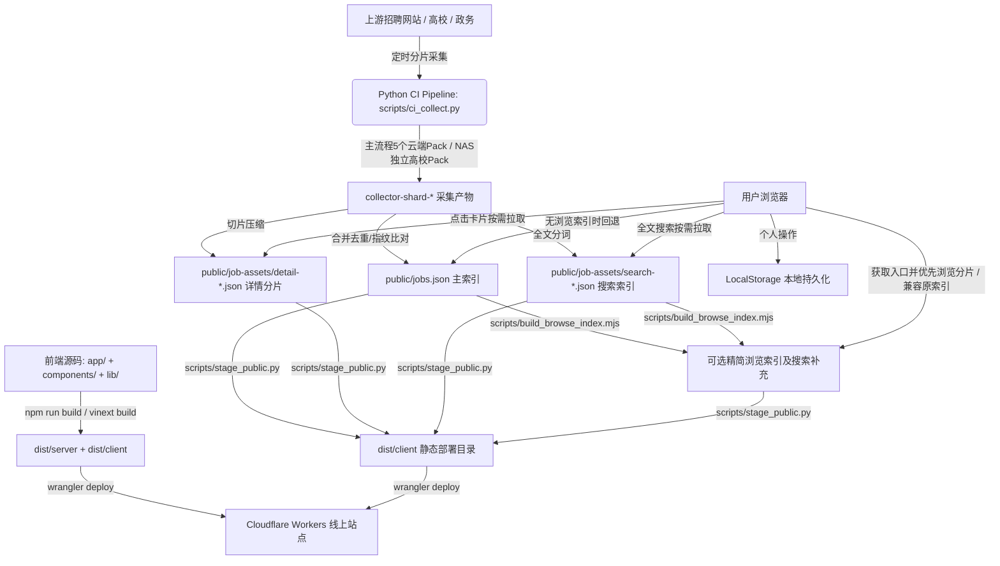

# 职讯雷达 (Job Radar) · AI 项目交接与上下文备忘录

> **适用对象**：后续接手本项目的任何 AI 助手（Claude, ChatGPT, Cursor, Copilot, Antigravity 等）或新开会话。  
> **使用方法**：接手本项目时，**优先通读本文档**，可直接掌握全部架构设计、数据流、踩坑规避点与验证命令，避免重复排查与设计偏离。

## 当前接手摘要（2026-10-30）

最新`890e8f4`已推送并启动正常云端采集、NAS独立采集与评价；Push Checks成功，正常云端分片均成功，部署验收待随后结果。其后仍在本地处理倒计时时区格式器热点与口碑部分列表发布覆盖历史的问题，见[发布记录末节](docs/deployment-20261030.md)。历史合并后的种子50家/34家有内容、178面经/70求助、5条明确归属历史体验（全2024）、19待核对、近一年0/分数0；下方旧0体验/22待核对按旧批次理解。发布历史恢复最多40秒、Node合并20秒，仍独立8分钟，不扩大180秒源站预算。

最新发布与继续实施见[发布验收记录](docs/deployment-20261030.md)。`6629af5`已推送，Push Checks和deploy_only成功，新界面实测可用；独立评价发布保留44家但更新API503，正在修复并验收。后续真实试采新增6家资料（当前内置50家、154面经、69求助、22待核对、确认员工体验/综合分均0），同济两页40场/3.14秒接入、筛选排序CPU优化已本地实施待后续发布。下方44家与“未提交”均为此前阶段；以发布记录与随后实际部署为准。使用者3000服务保持运行，3004是本批自建生产验收服务。

用户最新明确要求“先上线验收，然后继续：评价覆盖扩大、来源缺口与性能”，已授权本批提交、推送、部署、运行独立评价与后续正常采集验收。正在执行，结果须以随后发布记录为准；下方“未发布”是实施阶段状态。三个明确暂缓功能继续不实现。

后续用户已批准评价质量改进，最新见[评价归属与覆盖改进](docs/reputation-quality-20261030.md)。已实现归属待核对隔离、normalizer 3旧状态迁移、自动选择有内容栏目、有界企业候选发现与两页去重验证。**最新种子44家/28家有内容：22条旧体验转待核对，确认体验0、近期0、面经128、求助66、评分0**；下方22体验/近期1是迁移前历史数字。真实候选搜索未返回有效企业页、牛客公开读取出现initial-state缺失，故尚未扩大有效覆盖或证明真实翻页成功。预算仍180秒共享；31TS/20Python/17Edge及lint/tsc/build通过，未提交推送部署。使用者3000开发服务仍运行，本批未停止。下方“服务关闭”只对应上一批自行启动的服务。

使用者已批准按[后续计划](docs/roadmap-20261030.md)开发，并明确暂缓个人截止/跟进日历、个人条件匹配、关闭页面后的订阅通知。其余本地实施及边界见[10月30日开发与验证记录](docs/implementation-20261030.md)。基线仍为 `af79dd4`，保留全部已有修改；未提交、推送、部署、触发Actions或写真实数据分支，不沿用旧发布授权。

### 本轮后续功能

待投递数字/入口统一，保留全部收藏历史；新增投递阶段总览，复用原本机记录和锁。企业面板按保守身份聚合全部机会、历史、后续活动及独立工作城市，支持企业深链/分享；预览不伪报完整计数、索引完成不重置个人草稿。单页网址沿用replaceState及popstate恢复，不把个人信息加入URL。

评价独立流程改用本站公开岗位生成优先队列：已核对名称/别名、在招数量、缓存年龄与冷却，不读取本机求职记录。schema 2兼容schema 1，支持多provider、来源切换、原生评分与文字参考分分离，来源冲突不合并。真实仍只有牛客；看准官网本次正常浏览器确认已显示婚恋产品，未取得原点评渠道；脉脉自建采集器受限、尚无授权渠道，未假装接入。状态在 `config/reputation-providers.json`。真实试采79.64秒，累计44家资料、28家有内容、22体验/128面经/66求助；近一年体验1条、可评分0家。当前种子45JSON共190,944字节，索引35,651/gzip估算3,410字节。未降低门槛。

10月30日只读线上22,187条机会、最新发布10月30日、待补详情3,631条；不是10月26日历史快照。修正跨校转载的实际举办学校/城市和北大两处场地，保留source_school与原ID/时间，审计取消/线上分开。离线正确后续117场，线上3、未知物理场地5。新增华南农业大学、深圳技术大学BYSJY和南京信息工程大学91job匿名JSON日历；两页各40条，总源采集约8.20秒，0招聘详情请求，保留后续页码。注册现83源/27宣讲渠道，cloud universities-a加入3源，NAS pack与预算未改。上海交大/中石大接口明确要求登录、杭州未验证非空日历、政府403及历史积压仍是缺口，不承诺全国完整覆盖。

完整不可变索引缓存按版本/数量/哈希路径复用，失败不缓存，成功切回旧式inline快照时释放索引缓存；去重和统计按实际依赖复用，未选工作城市时跳过隐藏的三套全站筛选。历史20,823条离线暖读取0新增分片、共享数组；生产构建/本地Workers/隔离Edge首卡0.66–0.92秒、全量4.63–5.31秒、暖刷新0.78–0.79秒/0索引请求，同条件18,832结果。完整处理仍有1.8–2.1秒长任务，不宣称性能全部解决；不能冒充公网或真实手机CPU性能。

定向66TS、58Python、76Edge场景及lint/tsc/build/Actionlint通过，另外真实44家种子在生产构建读取成功；未跑全仓库测试。评分按每条员工体验的读取时间卡7天，不能靠新读取面经替旧员工体验续期。原始证据在忽略目录 `data/implementation-20261030/`。GitHub Actions只读API403限额，未核验最新运行状态；真实数据分支发布/API、三个新日历正常云端发布后的显示待发布验收。本轮自行启动的3000开发服务、3004本地Workers和隔离浏览器在结束时关闭，未停止其他使用者的进程。下面各10月29日及更早段落是历史阶段记录，不能以其旧种子数、来源数和端口状态替代本摘要。

### 企业口碑第二阶段

用户要求继续后续开发；已接入牛客正常公开企业页的员工体验/面经/求助分类、原文日期与短摘句、工作城市/岗位/部门筛选、原文主题归纳，以及有样本门槛的体验倾向参考分、列表筛选和两种排序。个人意向继续只保存在本机。具体边界、操作、命令及发布验收见 [第二阶段记录](docs/employer-reputation-phase2-20261029.md)。

50个注册ID不等于评价覆盖。三次真实试采分别36.84/39.45/17.97秒，合计62请求、38家尝试；21家成功读取，其中9家有内容，7条体验（近一年1条）/33条面经/28条求助。达到综合评分门槛0家，不能把浏览器合成测试的4.3分冒充真实评分。20,823条历史岗位离线匹配21条完整名称、1,312条范围参考，原数据未改动；集团/简称参考不套用于子公司评分。种子22个JSON共68,510字节，索引17,097字节（gzip估算1,850），按需加载详情，不塞进岗位索引。

新增独立 `Employer Reputation Pipeline`（北京时间06:30），30家/180秒采集预算、195秒外层保护、8分钟job上限，48小时成功缓存、4小时失败冷却、连续3失败停批。校验robots/身份，受限页面保守失败并保留旧资料，不登录或绕过限制。独立 `reputation-data` 分支保存公开数据，固定同源只读API传递，岗位/NAS不等待，main采集流程未改动。作者散列去重、面经不计员工分，每维至少10账号/至少3维才出综合分；来源超过7天未成功读取停用评分，缺失null不补零。个人企业ID与备份v4保持兼容。

39项定向TS、13项Python、15项新口碑+49项原有Edge场景及lint/tsc/build/Actionlint通过，未跑全仓库测试。证据在忽略目录 `data/reputation-20261029/`。尚未提交、推送、部署、触发Actions或真正发布数据分支；FakeGitHub模拟发布不算上线。使用者已有3000服务未停止。发布需届时明确指令，先验收实际写权限/API/缓存与成功覆盖，不沿用旧授权。

### 企业口碑第一阶段

用户批准实现企业身份、口碑面板、评价来源入口和个人评分。卡片/表格/详情的企业名称可打开按需加载的口碑面板；按完整名称或保守来源范围建立稳定档案，集团/部门/分公司分别记录，联合招聘不创建混合评分。个人意向1–5分及备注存本机，跨页同步、冲突保留草稿，备份升级v4并兼容导入v1–v3；不要把个人分数写成企业公众口碑。术语见 [CONTEXT.md](CONTEXT.md)，边界及命令见 [企业口碑记录](docs/employer-reputation-20261029.md)。

本期未自动采集第三方评价，外部入口是必应限定站点检索，不是已核验的企业页面。未新增采集/导出/工作流步骤或网络请求，不影响岗位采集等待路径；20,823条历史记录离线身份计算约28.66毫秒，50个真实完整名称试点通过，不能把它当成评价覆盖率。40项定向TS、49个Edge场景及lint/tsc/build通过；未跑全仓库测试。全部JS资产gzip合计增加8,740字节，含按需面板，不是首屏传输实测。仍未提交、推送或发布，使用者已有3000服务保持运行。

### 本轮界面与个人记录修复

用户批准修复10月29日审查确认的7项缺陷，现已在本地完成：多标签页个人记录一致性、跟进草稿与投递快捷操作、备份全状态冲突规则、手机提醒浮层避让、多城市标签换行、日期截止提醒和全文搜索重试。实现与边界见 [修复记录](docs/ui-fixes-20261029.md)；修复前证据保留在 [审查记录](docs/ui-code-review-20261029.md)。

基线仍为 `af79dd4`，本轮未提交、推送、部署或触发采集。保留接手时已有的卡片、样式、本文档修改；下方顶部压缩的提交/推送授权只对应之前批次。23项定向TS单测、新增18项及原有20项Edge场景、lint/tsc/build通过，未跑全仓库测试。个人记录与备份写入共享Web Locks，保存只合并本次编辑字段；不要恢复整表覆盖或按更新时间强制重建表单。未变动采集流程和NAS预算，无需重建容器。使用者已有3000端口开发服务未被停止。

### 目标与仓库状态

- 用户的首要目标：岗位机会与宣讲日程尽可能全面、及时，同时控制采集时间；性能和界面优化不能以漏采、删记录或错误筛选为代价。
- 所有 Git、npm、Python 命令在 `D:/code/get_job/web` 执行。保留 Claude 界面与已有 Gemini 优化，主样式为 `app/design.css`，增量样式为 `app/feature-updates.css`，不要重新启用旧 `app/workspace.css`。
- 本次更新包含页面顶部空间紧凑化重构，移除冗余提示文案，将采集新鲜度整合至求职操作栏，经用户明确指令执行本次提交与推送。保留 Claude 界面与已有 Gemini 优化，主样式为 `app/design.css`，增量样式为 `app/feature-updates.css`，不要重新启用旧 `app/workspace.css`。
- 10月30日已读取当前生产岗位快照并保留审计；Actions只读API因403限额未核验成功。最后一次完整部署验收仍为10月26日；下方更早的“未查询/未发布”按各批次日期理解，不代表当前线上版本。
- 不沿用旧轮次的发布授权：后续提交、推送、触发采集或部署，应按届时用户明确指令执行。禁止覆盖现有修改。

### 已完成及证据入口

| 批次 | 已实现内容 | 详细记录 |
| --- | --- | --- |
| Gemini 审阅修复 R1–R8 | 临时预览与完整快照分离、慢详情竞争修复、完整筛选网址、多城提示、旧 ID 深链、官方来源品牌、未知单位性质及空企业活动标题 | [修复记录](docs/gemini-fixes-20261028.md) |
| 采集与日程优化 | 南开/北大/BYSJY 日历按两页预算续采、失败重试、首片 256 KiB、日程高级筛选折叠、导出按钮对比度及空白修复 | [优先改进记录](docs/priority-improvements-20261028.md) |
| 精简浏览索引 | `browse_index.version=1`、共享 TS 薪资/阶段/变更规则、摘要预览 120 字符、按需搜索/详情、原索引兼容、两条工作流生成与 staging | [浏览索引记录](docs/browsing-index-20261028.md) |
| 顶部降高与提醒浮层重构 | 消除下挂复选框与冗余换行，求职提醒重构为看板内一体化 Bell 浮层面板 + iOS 风格 Switch 开关；顶部高度压缩约 60%，首屏机会大幅上移 | components/personal-reminders.tsx, components/top-action-card.tsx |
| 岗位卡片排版紧凑化重构 | 消除多余独占行，城市筛选提示内联至城市微标，默认无增量价值的“有效性待核实”标签按需淡化/隐藏，卡片高度压缩约 40px | components/job-card.tsx, app/feature-updates.css |

最新完整历史样本：32,411 条原始来源→20,823 条合并列表，同一数据的列表 gzip 7,647,384→4,811,096 字节（减少约37.1%），JSON 51,542,425→37,634,024 字节；38 组筛选、8 组查询、8 城日程一致，来源 ID 和历史时间保留。这是 **10 月 26 日历史样本的本地实测**，不是最新线上数据或新增岗位数。生成精简投影本机约2.027秒、零网络；实际云端新增耗时与 NAS 整轮耗时尚待上线核对。

最新批次通过72项定向前端单测、跨 Node/Python 交付验证、20个 Edge 场景，以及 lint/TypeScript/生产构建/Actionlint。完整样本在本地 Workers 运行时验证桌面1440px/手机390px；首次仅取浏览分片，未预取全文/详情。验证范围及时间见各批记录，不把历史通过当成新修改后自动通过。

证据在被忽略的 `data/browse-20261028/`、`data/priority-20261028/`、`data/review-gemini-20261028/fixes/`；这些目录不保证存在于其他 checkout。通用测试不可依赖其中的大文件。最新测试服务3002/3003与隔离浏览器已在验证结束时关闭，勿误停其他使用者的服务。

### 当前运行链路与不可破坏的约束

- `Push Checks` 做代码检查和构建；普通 push 本身不启动日常采集/发布。主流程每天北京时间05:00/14:00，5个云端 pack；NAS高校流程04:00/13:00，独立执行 `universities-b`，主站不等待 NAS。主流程正常手动运行会派发独立 NAS 流程；`deploy_only` 不采集。
- 当前注册83个来源、6个 pack，其中27个 `channel=talks`；注册数量不是本轮成功巡检数量，也不是完整学校覆盖数。SDEI为18校，5个核心校每轮活跃，其余13校分4组轮转；最新页优先巡检与历史续采分开。新增3个独立云端日历不扩大SDEI或NAS；以代码注册表为准。
- NAS单源90秒、分片1200秒；云端单源180秒、分片1080秒。保留共享限速、拒绝冷却、失败退避、队列和检查点。企业在架岗位必须完整单轮校验，不能套用部分续采来判下架。
- 宣讲举办城市、学校/场地与岗位工作城市独立。保留全部来源、别名、收藏/投递身份与原核验时间；导出、缓存命中和离线回填不得伪造“刚核验”。
- `browse_index` 是可选浏览投影；原索引/详情/搜索是兼容与还原依据。薪资、阶段、变更不能从120字符短摘要重新推断；浏览资产必须参与哈希、数量、唯一 ID、大小和 staging 校验。失败预览不能冒充完整统计。
- 个人数据仍只存在当前浏览器，保留旧存储键与备份兼容；网址仅同步筛选和岗位 ID，不上传备注或投递记录。
- 默认开发预览读取线上数据；隔离测试用 `JOB_RADAR_PREVIEW_DATA=local`。本地 `public/` 含历史小样本，不能拿它证明线上陈旧，也不能覆盖线上完整快照。

### 接下来优先处理

1. 如继续发布验收，先核对 `2c885ef` 的 Actions、部署版本和线上 `jobs.json` 是否已有 `browse_index.version=1`，再决定是否需要新的手动运行；不要根据本地跟踪引用推断成功。
2. 如只验证页面/性能，新版 `deploy_only` 可从完整线上快照生成精简浏览资产；若要验证日历续采和新岗位发现，必须使用最新代码的正常采集。旧运行的 Re-run 不会换成新提交。无需为这些改动重建 NAS 代理或 Runner 容器。
3. 继续逐源核验新鲜度、失败/冷却、待补详情、最新发布与活动时间。中石大/复旦日历认证、邮储空栏目及部分陈旧渠道仍有缺口；不能宣称全国完整覆盖。
4. 提高企业/单位、截止日期、届别、具体岗位、投递入口和结构化薪资质量，使用真实样本回归；保留真实性提示，不把未知字段补成确定答案。
5. 后续产品项仍包括界面降噪与控件统一、订阅通知、企业聚合页、个人匹配、投递看板/截止日历。当前页面内提醒不是关闭网页后仍生效的推送；这些未因本轮性能优化自动完成。
6. 浏览列表仍约37.6 MB JSON，内存与全文搜索负担尚可继续优化；进一步变动必须复用同数据筛选/日程一致性及实际浏览器验证。

## 历史实施记录的阅读约定

以下按发生时间保留。各段的“未提交”“已上线”“需批准”和数量/耗时只表示当时状态；当前接手摘要、现行代码与新核验结果优先。不要把已解决问题当成待办，或将历史授权视为新轮次授权。

## 2026-10-28：精简浏览索引已实现并验证（实施时记录）

用户要求继续建议优化项；本轮保留此前全部修改，实现可选 `browse_index.version=1`。说明与复验命令见 [浏览索引记录](docs/browsing-index-20261028.md)。仍未提交、推送、部署或触发生产采集。

`scripts/build_browse_index.mjs` 用现有 TS 领域函数预计算薪资/招聘阶段/变更依据，摘要预览 120 字符，历史与来源明细按需详情；原完整索引/详情/搜索继续保留，旧客户端可用。构建时先全量去重，浏览器不重复合并精简预览；原 ID/别名、工作地证据及同岗位资格匹配不删。全文复用原搜索并补回未包含的完整摘要，首次不下载全文/详情。版本化省略规则及禁止从短摘要重新推断见说明。

同一完整历史样本 32,411 来源→20,823 列表：gzip 7,647,384→4,811,096 字节（约少37.1%），JSON 51,542,425→37,634,024（少27%），仍需全量加载浏览列表。全部薪资/阶段/来源/ID、38组筛选、8查询、8城日程一致，原来源与时间可还原。本机构建投影约2.027秒、零网络；不增加NAS采集预算。两条流水线在staging前调用Node脚本，新版deploy_only亦可从完整旧快照生成，无需重采。

72项定向TS、1项Node/Python交付测试、20项Edge场景、真实完整样本生产构建桌面/手机验证及lint/tsc/build/Actionlint通过；未跑本地全仓库测试。证据在忽略目录 `data/browse-20261028/`。不要删原索引来缩部署目录；新增浏览资产必须参与staging/仅发布下载哈希校验。订阅/企业页/推荐与受限来源仍未完成，下方旧批次性能边界以本条为后续进展。

## 2026-10-28：继续推进日历续页、首批加载与日程简化（实施时记录）

用户要求按建议推进；本轮保留已有 Gemini / R1–R8 修改。实现与量化边界见 [本轮记录](docs/priority-improvements-20261028.md)。仍未提交、推送、部署，勿沿用旧发布授权。

南开、北大、BYSJY 两校日历接入检查点续页，保持每轮两页预算；BYSJY 只有 has-more，不能按首页总页数 2 重置深页游标。首批索引预算 256 KiB，后续仍 4 MiB；五个前端未用的内部字段只留详情。冻结 21,043 条数据首片 gzip 616,925→39,075 字节，但全量仍约 7.5 MB 压缩/50 MB 解析，勿宣称解决全量加载上限。37 组筛选与 8 城日程前后相同；独立 32,411 条历史状态离线还原 ID/时间通过。

日程城市/学校并排，日期快捷按钮，其余折叠；已生效隐藏条件仍展示且可清除，保留城市学校。少量活动取消强制大空白。28 Python、16 TS、17 Edge 场景及 lint/tsc/build 通过；本地只跑定向测试。证据 `data/priority-20261028/` 被忽略。发布后需正常合并导出新数据才能体现小首片，旧产物部署不会生效；NAS 容器/代理不用重部署。认证来源、全量列表精简、推送与企业页等仍未完成。

## 2026-10-28：Gemini 审阅问题已在本地修复（实施时记录）

用户要求按审阅建议修复 R1–R8；保留 Gemini 已有界面、多城标签及分享修改。结果与复现命令见 [修复记录](docs/gemini-fixes-20261028.md)。本轮尚未提交、推送或部署，未触发采集；勿沿用 10 月 26 日的发布授权自动推送这些新改动。

首次加载现在区分临时卡片预览与完整索引，下载失败撤预览、暖刷新失败留完整旧结果；详情按快照隔离，首批预览完成不再作废慢详情。网址恢复完整筛选、兼容多城、旧 ID 别名和浏览器历史，缺失岗位链接保留并提示。日程企业为空时保留活动标题；单位性质未明确不再混入企业；多城提示只列本条匹配城市。

新增 `config/employer-brands.json` 与 `scripts/employer_identity.py` 必须随代码保留：只用已注册官方海信/海尔来源补品牌与部门派生字段，不从任意标题猜企业，不改原始 company / ID / 历史时间；公开投影、索引/详情/全文搜索与可选分组均有覆盖。未增加源站请求、依赖或 NAS 预算，无须重建 runner。仍下载全量索引；精简字段导出尚未实施，不宣称已减少全量传输量。

本地定向前端82项、Python7项、实际Edge15场景，以及lint/tsc/build通过；按要求未跑本地全量测试。浏览器脚本 `tests/browser-regressions.mjs` 只在专用本地服务拦截最小样本，隔离上下文测试桌面1440px/手机390px，无横向溢出。证据在忽略目录 `data/review-gemini-20261028/fixes/`，不应作为其他机器的测试依赖。认证/空栏目/旧来源陈旧限制仍保留。

## 2026-10-26：多城市与求职工作台已发布并通过线上验证

用户已明确授权提交、推送、采集部署与生产检查。功能 `9ce0da5`、南开分页补正 `ab0177f` 已推送并上线；云端40281131137、NAS40281146014、复用云端产物的最终恢复发布40283349624及两次Push Checks均success。Cloudflare最终版本 `1a5c9790-d6c2-4192-a5c7-71d0e1a3a061`。详见 [发布记录](docs/deployment-20261026.md)，下方本地实施/发布中内容为先前阶段记录。

线上最终21,043条索引、32,719条原始来源、369城市，快照实际采集时间15:01:20。原32,411个来源ID、云端与NAS本轮增量全部保留；恢复发布未刷新索引历史时间。9场地点及微玖北京工作地在线核对通过。新增南开/北大日历各40条，当前未来活动不是80场；南开原两页误判末页问题已补正，旧状态公开投影明确最近两页覆盖不完整，不伪造成功时间。下一次正常采集使用正确末页解析，仍有页面/时间预算。

最终CI全量212项Python、76项前端及lint/tsc/build通过；实际线上Edge验证多城市保存、独立日程、北京活动、桌面/390px手机通过。NAS实际基线11秒、环境复用2秒（无包下载）、采集20分18秒、上传7秒；完整NAS含准备与发布24分43秒。云端完整7分19秒，最后恢复含锁等待5分02秒，不能把外围耗时算成采集时间。限制仍见实施/发布报告，尤其源站认证、空栏目与旧渠道陈旧，不宣称全国完整覆盖。原始验证大文件在忽略目录 `data/release-20261026/`，不可提交。

## 2026-10-26：多城市与求职工作台本地实施记录

用户已要求按详细计划实现并评估耗时。本地修改基于 `87edcf6`；结果、验证口径与未完成来源见 [实施结果](docs/implementation-results-20261026.md)。实施验证时尚未提交、推送或部署；用户随后明确要求“提交推送部署吧”，已授权提交、推送及正常采集部署与生产检查。具体发布结果须以随后记录的提交及运行状态为准，不能把已触发当成已成功。

发布中复核：功能提交 `9ce0da5` 已推送；Push Checks与云端正常采集发布成功（运行40281131137），线上已是369城市/20,998条，新日历两源各40条、9场地点和微玖工作地核对通过。NAS运行40281146014仍需等最终结果。线上复核额外发现南开分页不能把“下一页2”当总页数；实际官方末页10，已改解析末页。旧无分页版本状态在公开投影中降为“最近N页，更多待核实”，不改变原始核验时间；后续需复用本轮产物发布该修正，避免重复采集。

统一城市注册表（2024版内地369个地级/直辖/省直管单元、2846县级对应），生成TS、Python同源读取；公共线索城市查询独立固定，扩UI字典不扩每轮请求。修复9场宣讲城市（淄博6/聊城2/潍坊1）、单位所在地污染岗位城市、旧岗位表地点补投影；完整原始ID、历史时间保留。新增覆盖哈希资产与来源缺口说明，两个官方云端日历源（南开、北大）有界实测成功。中石大/复旦日历认证、邮储空栏目、部分旧渠道陈旧仍有限制，未宣称全国完整覆盖。

新增多工作城市、独立活动城市/学校/日期/类型、活动收藏和ICS导出、资格按同岗位行联合筛选、保守招聘有效性、投递阶段/时间/备注及页面内提醒。旧本地键和v1/v2备份兼容，导出v3支持活动与设置，导入先验证/冲突预览/事务保存；不上传个人数据。后台推送/跨设备同步仍为后续服务。保留Claude界面；新增样式在 `app/feature-updates.css`，不要重新启用旧 `workspace.css`。

验证：Python3.12定向155项、前端定向72项，lint/tsc/build/字典生成检查通过。完整32,411条来源离线重导出20,823条合并索引，manifest/分片/历史及全部来源ID还原通过；零新增采集请求。本地同机3次完整导出中位38.884→32.228秒（快约17.1%，不是NAS总耗时），两新源首页面小窗口合计约6.6秒。NAS90秒/源、1200秒软预算，云端180秒/源、1080秒分片预算保持，依赖/镜像/代理未变。实际Edge隔离上下文验证桌面/390px手机、城市持久化、活动收藏、ICS下载、投递保存与备份恢复。真实日历应用导入、生产资产与完整NAS时间尚未验证。

`scripts/reproject_snapshot.py` 只向独立空目录回填；不能覆盖原输入/public或刷新官网核验时间。忽略目录 `data/implementation-20261026/` 有完整真实输入、报告和本地预览数据；不提交这些大文件。部署必须用当前代码重新合并/导出，`deploy_only` 复用旧数据不能证明地点修复。当前新增配置目录必须随代码提交；`scripts/generate_city_registry.py --check`已加入Push Checks。

## 2026-10-26：多城市审计实施计划（原始计划记录）

用户本轮要求将已发现的问题整理为其他 AI 可执行的详细步骤，未要求本轮实施业务修复。实施规格见 [多城市覆盖与求职工作台实施计划](docs/implementation-plan-multicity-and-job-workspace.md)，便携回归样本见 `docs/fixtures/city-audit-20261025.json`。文档基于 `87edcf6`，数据证据为 10 月 25 日审计，不能当作当前实时数量。

优先处理：9 场已采宣讲缺举办城市、城市字典缺项与前后端不一致、公司注册地污染工作城市；扩城市字典前必须解开 OfferJack 默认城市查询与 `CITIES` 的耦合，避免请求量膨胀。随后补城市覆盖说明、失败/陈旧来源、有界补源、在招有效性，再完善多城市筛选、独立日程和个人投递跟进。文档包含修改入口、数据兼容规则、离线回填、测试矩阵、发布与回滚步骤。

本次仅新增文档和最小证据样本，未修改业务代码、未采集、未推送、未部署。完整审计目录 `data/city-audit-20261025/` 被忽略，其他 checkout 不保证存在；不要让回归测试依赖它。后续按用户明确要求执行相应批次，勿把本文中的待办当作已实现功能。

## 2026-10-24：生产发布验证与单位识别码修正

用户已批准本轮提交、推送、正常采集及生产检查。主修复 `0a257c2` 已推送，CI 全量测试发现旧断言将高校数写死为 17；`b1a9e5d` 改为核对注册表并验证中医药大学在核心轮转中。恢复发布运行 `40071710604` 与 NAS 运行 `40071581546` 均成功；后续正常云端 `40084431606`、NAS `40081116842` 也成功。

10 月 24 日 20:05 直接读取线上快照（生成于18:09），20,586 条记录、最新明确发布日期10月24日。实际前端函数及浏览器宣讲栏均显示济南74场、6校（山大46、济大16、齐鲁9、建筑1、山师1、山财1）。中医药大学当天5场已于17:00前结束，退出后续日程属正常；仍保留其14条日程记录。原线上12场/3校。NAS实际采集约20分钟，基线10秒、环境2秒；云端高校分片约3分钟，不能将单独日历巡检3分钟说成整轮NAS时间。

浏览器发现部分新增正文复用记录的 companyName 是18位机构识别码；refine_facts 现在剔除此伪名称并保留 company_original，只用已有明确标题/简称规则补企业名称，未能证实则保持未知。19项相关定向测试通过。随后复用已有云端产物重新合并发布，无需重复采集。验证文件在忽略的 data/deploy-verification/。

## 2026-10-24：补齐高校宣讲渠道与快速日程

本轮基于 `6c06b90`，保留 Claude 的界面与高校筛选。新增 `scripts/campus_talks.py`：山大五周日历、山东建筑大学/山东交通学院 BYSJY 日历、山师研究生网近期宣讲通知；SDEI 新增山东中医药大学三渠道。现有 21 校 22 个宣讲源；山师的 SDEI 空列表不代表研究生站无活动。山师 www HTTPS 证书主机名不匹配，使用已核验的公开 HTTP 入口，不关闭 TLS 校验。

官方日期/学校/场地先发布为 `kind=宣讲会`、`event_verification=official_list`，招聘资格与工作城市待正文核验，不能用活动地点代替工作地点。NAS head pass 不等正文；后台每源最多补八条，SDEI 优先解析列表自带完整 `fairDetail`、额外网络详情最多两条。缓存正文核验时间与日程检查分离；取消场次退出日程，已过日期不补正文。修复“千佛山”包含“佛山”造成的误定位。日志恢复保留日程和待补队列，失效招聘正文保留在 raw state、公开只展示仍可核实的日程。

10 月 24 日 13:33 本地真实巡检约 3 分钟，导出 580 条日程，前端实际筛选得到后续 149 场、济南 78 场/7 校（山大46、济大16、齐鲁8、中医药5、建筑1、山师1、山财1）。89 项 Python 定向测试、7 项前端定向测试通过，真实快照筛选通过。未运行全量测试，未执行整轮 NAS 生产采集。用户已于 2026-10-24 明确批准提交、推送并触发正常采集，检查生产发布结果；单独 deploy_only 不补数据。细节及已知未覆盖渠道见 `docs/campus-calendar-coverage.md`；联网测试数据位于忽略的 `data/talk-coverage-audit/`。

## 2026-10-22：数据新鲜度与有界优先采集

本轮直接核验线上 19,742 条记录（10 月发布 4,032 条），最新明确发布为 10 月 22 日；当日 22:26 后续宣讲 24 场，其中济南 15 场。9 月 11 日首条来自本地 9 月 14 日旧快照。Vite 开发代理现在默认读取线上 jobs.json/job-assets，显式 `JOB_RADAR_PREVIEW_DATA=local` 才使用旧样本，读取方式会显示在页面覆盖说明中。保留 Claude 的 design.css 与现有界面。

NAS `--freshness-first` 在所有学校最新页巡检之后才进入旧详情/历史轮转；最新页总预算 70%、单源最多 30 秒，不推进历史游标。后续每源 90 秒、采集软预算 1200 秒，下载/环境/构建另计。失败详情带持久退避，未完成记录与队列均保留；重要列表字段变动会使缓存失效。不要移除共享限速与上游拒绝冷却。齐鲁工大缩小公告页并有界读取较大 JSON，真实独立进程采得 10 条最新公告、后续缓存复用成功。银行链接日期及未来来源发布日期投影也已修正。

新增 scripts/audit_freshness.py、collection_plan.py，tests/test_freshness.py；两条合并工作流生成 freshness-report.json 及人类可读摘要。前端新增 data-health.ts/组件/样式，显示真实巡检覆盖、待补详情与筛选日期；宣讲栏可展开全部场次。操作与预算解释见 docs/data-freshness.md。本轮不覆盖 public 历史样本。用户已明确授权将当前界面及功能改动提交、推送，并触发一次正常采集验证；旧任务 Re-run 使用旧提交。

验证：68 项 Python 定向回归、8 项前端定向测试、lint、TypeScript、生产构建与两条工作流 Actionlint 通过。浏览器实际读取线上 19,742 条记录，核对最新发布 10 月 22 日、济南 15 场后续宣讲及全部展开；右侧安排栏增加独立滚动，避免宣讲入口被过高的固定侧栏遮住。保留接手前已运行的 localhost:3000 服务。未执行全量测试或整轮 NAS 实际采集；真实单源已验证，整轮耗时及覆盖改善需新提交的正常流水线确认。

## 2026-10-22：求职工作台改版

- 首页改为搜索、筛选方案、招聘列表与求职安排。桌面三栏，窄屏将待投递和宣讲日程放进「我的安排」折叠面板；手机筛选走抽屉。新增 `app/workspace.css` 承接工作台样式，保留既有详情、表格等基础样式。
- 岗位卡突出企业、薪资、工作地、学历、截止时间和行动按钮；摘要仅视觉折叠，不删数据，完整正文仍从详情分片读取。直接标记已投只改本机记录，不提交申请。
- `lib/workspace.ts` 计算待投递队列与宣讲日程：收藏且未投、未隐藏、未截止的机会按截止时间排列；宣讲按活动城市及北京时间筛选，保留来源关联、去掉已结束场次，同一活动优先打开关联招聘卡。测试为 `tests/workspace.test.ts`。
- 进入收藏、已投或不感兴趣时使用不受发现页条件限制的初始筛选，包含已截止信息；返回发现页恢复当前会话之前的条件。保留所有原有存储键和备份格式，不迁移、不清空记录。
- 保存筛选方案包含全部筛选字段，应用时先恢复默认再应用方案，避免上个方案残留。存储失败明确提示。今日发布/收录和补录数量与筛选共用判断函数，使用北京时间处理跨零点记录。
- 修复桌面/手机重复导入输入框引用、重复学历字段 ID、详情切换时岗位内搜索残留、表格网格撑宽页面。`/` 快捷键聚焦搜索。
- 验证：12 项前端定向测试通过（workspace/radar/browsing/talk-events），lint、TypeScript 与生产构建通过；浏览器验证 1440px 桌面与 390px 手机、收藏/已投切换、方案恢复、抽屉与表格横向滚动。
- 本地仓库附带的是 2026-09-14 历史快照，预览出现过期提示属实；本次不改数据、不触发采集、不部署。

## 2026-09-23：宣讲会作为招聘卡的关联活动

SDEI 宣讲会从 `fairDate/fairStartTime/fairEndTime/schoolName/fairAddress` 提取独立 `talk_event`；历史已验证记录可从保留的结构化字段和正文补齐，无需重采。宣讲地点独立于岗位工作地及网申截止时间。城市优先取活动场地明示信息，再对学校官网已核对的实体校区映射；线上或无法核实地点保持未知。发布时宣讲来源作为独立原始记录保留，仅在企业名称或明确声明的简称、毕业届别匹配且目标招聘卡唯一时附加 `talk_events` 与 `talk_attached_to`。普通列表隐藏已关联宣讲来源，收藏等个人视图仍可找到原记录；未能可靠匹配的宣讲会继续独立显示。卡片、表格和详情按所选城市展示活动日期、学校、场地及原文链接；宣讲城市可以让相关招聘卡出现在该城市筛选里，但标签明确指出工作地另核。第 86 轮三条真实来源离线验证为一张招聘卡附两场济南宣讲，快照重载仍恢复三条原始记录。

## 2026-09-23：公司简介补正企业名

refine_facts 从明确的公司/企业/单位简介段首提取唯一完整企业名，要求去除公司后缀后的名称以标题中的企业短名结尾（至少 4 字符）。只补正缺失或冲突的公告企业名，不处理具体岗位、不按投递链接合并；保留 company_original 与来源冲突记录。历史数据在 public_record 导出时也会补正，无需重采详情。线上宇视两条真实公告验证 2→1，两个来源保留，不同届别仍分开；2 个定向测试通过（包含客户介绍、无关企业、多候选和重复补正）。不运行全量测试。需提交后正常合并发布生效，deploy_only 仅复制旧线上数据不会补正。

## 2026-09-22：高校专项流水线独立解耦与主站无人值守保障

仓库转为 Public 后解除 2000 分钟配额限制。解决 NAS 离线导致主流水线挂起 24 小时的问题：
1. **主站日常流水线（daily-collect.yml）**：纯云端化。固定运行 5 个通用分类（政务、高校A、金融、大厂、公共），100% 运行于 `ubuntu-latest`，每天北京时间 05:00、14:00 自动触发，10~15 分钟无人值守准时发布。合并时自动以只读形式完整保留线上快照中的高校历史数据，彻底免疫 NAS 停机或家庭网络波动。
2. **高校专项流水线（nas-universities.yml）**：独立解耦。每天北京时间 04:00、13:00（比主站提前 1 小时）在 `job-radar-nas` 自建 Runner 上运行 SDEI 17 所高校的直连抓取，并在云端合并增量发布。NAS 离线仅此工作流排队，不影响主站。
3. **数据一致性**：两路工作流均依托同一线上快照（`sites-project.job-radar.workers.dev`）与 GitHub Actions 共享缓存互为基线，增量平滑融合。

## 2026-09-22：无损索引分片与失败发布恢复

第 86 轮产物本地还原得到 12,711 条公告、26,503,211 字节主索引，超过 Workers 单文件 25 MiB。保留全部字段，超过 4 MiB 的列表按记录分成内容哈希命名的 index 资产；磁盘 jobs.json 为 schema 3、jobs 空数组、index_shards/index_count，export_snapshot 返回值仍含完整 jobs。全文搜索同样按记录分片，search_url 为第一片，search_shards 为剩余片。前端按最多 4 路加载，收齐列表才展示；prepare/snapshot_state、发布复制和 deploy_only 下载兼容新旧快照。生成及 staging 都检查 25 MiB 上限，单条异常大数据仍会明确阻止发布。完整正文、摘要、筛选字段不截断。

手动 reuse_run_id 下载同仓库指定运行的基线和六个分片，跳过新采集，执行当前代码质量检查、合并完整性检查和发布。恢复要求六个分片齐全；不要同时选择 deploy_only/baseline_diagnostic。第 86 轮运行 ID 为 35697829191；产物只有 2 天保留期。未替用户推送或触发。本地分析产物在 data/run86-analysis（忽略目录）。

验证：第 86 轮七个真实产物离线合并成功，12,711 条列表记录、全文搜索文本及详情字节保持一致，入口约 100 KiB，7 个列表片、6 个搜索片，最大数据文件 4,760,169 字节。分片往返、冷启动恢复、仅发布复制、超限拒绝、前端有界并发/失败处理及旧格式定向检查通过；TypeScript、定向 lint、Actionlint 通过。未执行本地全量测试或实际云端发布。

## NAS Python 环境复用（2026-09-22）

主工作流和兼容 NAS 工作流均调用 scripts/prepare_nas_python.py。虚拟环境保存在持久卷 /home/runner/state/python-envs，按 requirements.txt 内容、Python 版本与路径、CPU 架构取哈希；校验固定版本、关键模块导入及 pip check 后才能复用。仅首次、依赖变化或环境损坏时安装，国内镜像直连最多 150 秒，失败再尝试官方源最多 120 秒；脚本总预算 360 秒，步骤上限 7 分钟。失败不写 NAS_PYTHON，不开始采集。不会被仓库 checkout 清理。旧版本缓存暂保留，不自动删除。已做静态检查，定向 mock 测试待用户认可。

## 2026-09-22：高校基线传输

高校分片使用 `scripts/shard_baseline.py` 从本轮完整 state 生成的专用产物，保留高校 jobs/pending、全体 sources（共享冷却）和原始 last_run_at；独立 SHA256 输出绑定下载内容。下载步骤上限 5 分钟，上传分片 3 分钟。手动 `baseline_diagnostic` 优先于 `deploy_only`，仅准备、下载及验证，不采集或发布。说明见 docs/actions-cost-control.md。本轮新增 tests/test_shard_baseline.py，6 项定向测试通过（裁剪保真、共享冷却、哈希损坏、跨版本拒绝、文件缺失、空高校历史）；Actionlint 通过。未进行 NAS 实际下载验证。

## 2026-09-21：Actions 节省分钟变更（覆盖下文旧 NAS 交接说明）

提交仅运行轻量检查；定时改为每天 11:00。主矩阵高校分片现在直接运行于 NAS，不再让云端轮询子任务；这是本轮节省分钟的明确调整。NAS 离线会排队，需取消并手动跳过高校分片。仅发页面使用 `deploy_only`，按哈希复用线上真实快照。具体开关与限制见 [docs/actions-cost-control.md](docs/actions-cost-control.md)。用户要求本地只做定向验证，不执行全量测试；下文旧全量验证要求不适用。

## 1. 项目速览 (Project Overview)

- **项目定位**：个人招聘信息聚合看板（权威高校就业网、政务直聘、大型国企/银行招聘公告聚合与结构化检索）。
- **线上部署地址**：`https://sites-project.job-radar.workers.dev`
- **代码仓库路径**：
  - 工作区根目录：`d:/code/get_job`
  - **Git 仓库实际位置**：`d:/code/get_job/web`（所有的 git 命令、npm 命令、python 脚本均在此目录下执行）。
- **核心技术栈**：
  - **前端**：`Vinext` (基于 Vite 8 的 Next.js 兼容框架) + `React 19` + `TypeScript` + `Tailwind CSS 4` + 自定义设计系统规范。
  - **采集与数据管线**：`Python 3.12`（无头解析、多源抓取、去重归并、分片校验）。
  - **托管与发布**：`Cloudflare Workers`（Sites 静态托管与边缘分发，通过 `wrangler 4.92` 部署）。
  - **定时流水线**：GitHub Actions（每天北京时间 05:00、14:00 自动分片采集、构建与部署）。
- **当前提交与发布状态**：见本文顶部接手摘要；下方历史日志不代替实时 CI/线上核验。
- **运行要求**：Python 3.12；Node.js >=22.13.0；使用仓库锁定的依赖。

---

## 2. 核心架构与数据流 (Architecture & Data Flow)



### 数据交互与静态化设计
1. **轻量主索引与分片加载**：
   - `jobs.json` 是入口；schema 3 通过 `index_shards/index_count` 声明原完整列表，`browse_index.version=1` 声明可选精简列表。首次可预览首片，但完整数量/唯一性校验通过后才显示全局统计和日程。
   - 浏览列表摘要120字符，薪资/阶段/变更由共享 TS 规则预计算；原索引/详情/搜索继续保留。首片预算256 KiB，后续约4 MiB，浏览器最多4路加载。
   - `detail-*.json` 按 ID 前两位哈希分片，仅当用户点击“查看详情”时按需请求，不污染首屏带宽。
   - `search-*.json` 全文索引，仅当用户在搜索框输入关键词时异步拉取。
2. **纯前端免登录持久化**：
   - 用户的收藏、已投递、不感兴趣、阅读时间、筛选条件均保存在当前浏览器的 `localStorage` 中。
   - 网站本身无后端数据库，保证免登录、隐私安全与极低维护成本。

---

## 3. 关键目录结构与核心文件导览 (Key Files Map)

| 目录/文件 | 核心职责与设计要点 |
| :--- | :--- |
| [web/app/page.tsx](app/page.tsx) | 核心主页面。负责客户端 Hydration、异步加载 `jobs.json`、筛选、排序、分页与多视图（卡片/表格）呈现。 |
| [web/app/error.tsx](app/error.tsx) | 路由段级客户端错误边界，提供中文友好容错卡片（重试、清空缓存）。 |
| [web/app/global-error.tsx](app/global-error.tsx) | 根布局级全局错误边界，接管 Vinext 默认的英文未捕获异常白屏。 |
| [web/components/job-card.tsx](components/job-card.tsx) | 招聘卡片组件。支持薪资高亮、截止倒计时、生命周期徽章、多渠道同步折叠、快捷复制分享。 |
| [web/components/personal-radar.tsx](components/personal-radar.tsx) | 个人雷达组件。顶部快捷聚焦（今日新发、新开补录、3天内截止、近期变更）与预设管理。 |
| [web/lib/jobs.ts](lib/jobs.ts) | 领域模型与核心算法：`filterJobs`、`mergeDuplicateOpportunities`、`locationMatch`、`parseSalaryRange` 等。薪资显示提取在 `lib/salary-display.ts`。 |
| [web/lib/radar.ts](lib/radar.ts) | 雷达统计指标与预设方案计算逻辑。 |
| [web/lib/browsing.ts](lib/browsing.ts) | 本地浏览喜好安全还原（防范损坏的 LocalStorage 导致崩溃）。 |
| [lib/browse-index.ts](lib/browse-index.ts) / [lib/snapshot-loader.ts](lib/snapshot-loader.ts) | 精简浏览数据契约、投影、验证及有界分片加载。 |
| [scripts/build_browse_index.mjs](scripts/build_browse_index.mjs) / [scripts/audit_browse_index.mjs](scripts/audit_browse_index.mjs) | 用共享 TS 规则生成精简资产及离线一致性/体积审计；无源站请求。 |
| [web/scripts/collect.py](scripts/collect.py) | 核心采集器与适配器池（包含各高校、人社局、国企银行等几十个爬虫）。 |
| [web/scripts/ci_collect.py](scripts/ci_collect.py) | CI 调度驱动器。控制多分片执行、超时退避、轮换排期与分片合并。 |
| [web/scripts/stage_public.py](scripts/stage_public.py) | 校验哈希并把最新快照挂载到构建好的 Cloudflare 部署目录。 |
| [web/.github/workflows/daily-collect.yml](.github/workflows/daily-collect.yml) | GitHub Actions CI/CD 流水线定义。 |

---

## 4. 关键设计契约与必须遵守的铁律 (Critical Invariants & Gotchas)

### 规则 1：客户端 Hydration 防御（极易踩坑！）
- **SSR 与 Client 隔离**：`Home` 组件初次挂载时 `data` 为 `null`，`useEffect` 触发 `fetch('/jobs.json')` 异步加载数据。
- **来源状态可选性（Optional Properties）**：
  在 `jobs.json` 的 `sources` 列表中，因轮转休眠或限流冷却，很多来源的 `status` 为 `'deferred'` 或 `'blocked'`，**其 `errors` 数组可能为空或被省略**。
  - ❌ **绝对禁止**：`s.errors.length > 0`（会导致未捕获的 `TypeError: Cannot read properties of undefined`，整站崩溃！）。
  - ✅ **标准写法**：`Boolean(s.errors && s.errors.length > 0)`，数值必须带默认值：`s.pages ?? 0`、`s.discovered ?? 0`。

### 规则 2：SDEI 高校源防护策略
- 山东高校就业平台（`school.gxjy.sdei.edu.cn`）共享同一入口与 IP 限流策略。
- **核心校与4组轮转**：当前18校中5个核心校每轮活跃，其余13校分4组轮转；最新页优先巡检与历史扫描分开，不能把未读深页说成全量覆盖。以 `SDEI_SCHOOLS`、`CORE_SDEI_SCHOOLS` 和 `ROTATING_SDEI_GROUPS` 为准。
- **岗位接口按需联动**：仅当某高校的“招聘公告”本轮发现新增或内容变动时，才去触发请求“具体岗位”接口；无更新时岗位接口自动 `deferred`。
- **持续冷却机制**：一旦遭遇 403/420，记录 `blocked_until`（至少冷却 4 小时），后续采集直接跳过该主机，严禁暴力重试。

### 规则 3：LocalStorage 存储键规范
所有保存在浏览器端的键名均带版本后缀，读写必须用 `try...catch` 包裹：
- `job-radar-browsing-v1`：筛选条件、卡片/表格视图模式、合并同企业开关。
- `job-radar-page-size-v1`：每页条数（20 / 50 / 100）。
- `quancheng-personal-v1`：个人收藏、已投递、不感兴趣、阅读时间戳。
- `quancheng-last-visit-v1`：上一次访问时间戳（用于计算“新收录”提示）。
- `job-radar-presets-v1`：个人雷达预设方案列表。
- `job-radar-active-preset-v1`：当前激活的雷达预设 ID。
- `job-radar-agenda-v1`：独立活动城市、学校、日期、形式与类型筛选。
- `job-radar-event-personal-v1`：活动收藏及已观察到的安排，用于显示改期/取消。

个人备份兼容旧v1/v2，并以v3保留活动及设置；导入先验证与预览冲突，再事务保存。不清空旧存储来修复功能。

### 规则 4：安全规则（全局规范）
- **未经用户明确指令，绝不执行 `git push`**。
- **不得擅自丢弃或覆盖现有代码或修改**（禁止危险的 `git reset --hard`、`git clean` 等）。

---

## 5. 当前验证约定与命令

用户要求本机只跑与修改相关的定向验证，**不要执行全仓库套件**；CI按现行工作流做其配置的检查。文档更新只检查内容与链接，不重新采集、构建或跑业务测试。不得把旧批次的测试计数写成当前全仓库测试数。

业务代码修改时按影响选择相应模块；最近浏览索引批次的定向命令如下（其他主题不要机械全部重跑）：

```powershell
# 前端：浏览、筛选、阶段、日程等关联回归
node --experimental-strip-types --test tests/browse-index.test.ts tests/domain.test.ts tests/snapshot-loader.test.ts tests/multicity-workspace.test.ts tests/radar.test.ts tests/calendar-export.test.ts tests/talk-events.test.ts

# Python：浏览资产生成/还原/staging/仅发布下载兼容
python -m unittest discover -s tests -p test_browse_delivery.py -v

# 代码检查及构建（按变更适用性运行）
npm run lint
npx tsc --noEmit
npm run build
```

工作流变动须用 Actionlint；现有 `.github/actionlint.yaml` 定义自建 Runner 标签。浏览器回归脚本为 `tests/browser-regressions.mjs`，须用专用本地服务和隔离上下文，启动方法见 [修复记录](docs/gemini-fixes-20261028.md)。真实数据一致性用 `scripts/audit_browse_index.mjs`，不得将忽略目录变成必需测试依赖。

---

## 6. 最近重要演进记录 (Recent Changelog & Context)

- **`664d120`**：解决 SDEI 高校上游 HTTP 403 封禁问题。引入慢速专用通道（3~5s 随机抖动）、4 组高校轮流扫描机制、第一页内容指纹首屏早停。
- **`0fa71e6`**：落实审计反馈。实现 `blocked_until` 跨 Action 持久化冷却；修复岗位接口按需触发门禁（公告无更新则不扫岗位）；强化早停安全条件。
- **`53ce741`**：**修复线上白屏崩溃问题**。
  - 根因：`deferred` 轮转来源的元数据未包含 `errors` 属性，客户端解析引发 `TypeError`。
  - 修复：前端全链路可选链与空值保护；CI 采集补齐结构；新增 `app/error.tsx` 与 `app/global-error.tsx` 错误恢复边界。

---

## 7. 常见接手任务与指引 (Quick Recipe for Common Tasks)

### 采集续页与共享限速（2026-09-16）

> 本节包含旧 NAS 调度方案及当时机器状态。当前生产链路是独立云端/NAS双流程；涉及 `nas_dispatch.py`、`UNIVERSITIES_B_RUNNER` 或“尚未接入NAS”的描述不能作为当前配置依据，先看顶部摘要和现行工作流。

- 2026-09-18：SDEI 具体岗位必须通过真实 `edit1` 详情解析，不能用列表 `inline_html` 充当详情核验。`detail_verification=verified` 才能公开；旧的未核验记录、详情失败记录保留内部状态与待续队列，但不进入主索引、详情分片或搜索索引。正常详情提取 `.info-item`，补齐单位、专业和公开投递方式，排除学校页脚联系方式。发布 `raw_records` 计可公开原始记录，`withheld_records` 计隐藏记录；历史完整性仍检查内部 state，不可因公开隐藏而删除历史。回归测试见 `tests/test_position_verification.py`。

- NAS 首次云端运行 #45 的交接失败源于子工作流同时定义 `NO_PROXY` / `no_proxy`，被 GitHub 判定为重复 env 键，任务未派发。保留 env 中大写变量，在 shell 内 export 小写别名。工作流需用 actionlint 校验，普通 YAML 解析不足以发现 Actions 语义错误；自定义标签配置在 `.github/actionlint.yaml`。交接报告现区分 HTTP 接口错误、接单超时、执行超时与缺失产物，并提供子任务链接；不打印签名 URL 或令牌。

- NAS 分流为显式启用：仓库变量 `UNIVERSITIES_B_RUNNER=nas`。主矩阵仍在 GitHub 上，由 `scripts/nas_dispatch.py` 调度独立 `nas-universities.yml`，绑定父任务 ID/attempt/commit，获取同一基线。NAS 约 90 秒未接单或执行超过 1100 秒则取消子任务、保留高校历史，其他分片不被无限排队阻塞。不要直接把主矩阵的 runs-on 改为 self-hosted。
- 绿联 DH4300 Plus 为 ARM64；使用新的 `compose.nas-runner.yml` 和 `deploy/nas/`，不要使用旧的全站 NAS Dockerfile。NAS 不需要 Cloudflare 密钥或访问 workers.dev；通过 GitHub 产物交换基线及增量。原有分片基线/归属校验不变。启用前须实测家庭宽带直连高校、GitHub 联通及容器构建；当前本地 Docker 守护进程未启动，尚未实际构建 ARM64 镜像或接入 NAS。

- SDEI 请求失败记录 `request_diagnostic`（阶段、去除查询参数的地址、方法、状态码和耗时），不保存 Cookie、响应正文或认证参数。CI 报表区分“请求被拒绝”和“共享冷却跳过”；没有成功核验的分片不再宣称允许发布。
- 单源同会话诊断：`python scripts/diagnose_sdei.py --source jobsdufe-announcements --state data/state.json`。必须使用最新状态并遵守冷却；只读取一页，不采详情、不发布、不修改状态。`--network-route direct` 仅该进程直连，不修改系统代理。成功只表示该环境能读取列表，不保证 GitHub 云端可用。
- 2026-09-16 诊断：当前电脑 Edge、采集程序及单次直连均收到平台 403；用户确认手机移动网络可以显示招聘公告。当前不能据此宣称接口已修好，也不能保证换 NAS 就成功；需在可正常访问的网络验证同会话列表和详情，再决定采集运行位置。

- 预热请求遇到 403/420/429 时必须同步共享冷却并向上抛出，禁止继续调用招聘接口；普通预热超时或 404 仍可容错。`HostPaused.retry_after_seconds` 传递剩余等待时长，写入 `blocked_until` 时不得缩短有效的 `Retry-After`，仍保留至少 4 小时的跨运行冷却。
- CI 故障模拟测试捕获标准输出/错误输出，并断言预期告警；`GITHUB_STEP_SUMMARY` 必须隔离。不要让测试的 `::warning::` 污染真实 Action 告警。相关回归测试包括 `tests/test_cooling_contract.py`；本轮完整 Python 套件为 122 项。

- 可按页码访问的公告源保存 `resume_page`：预算至少为 2 页时，每轮刷新首页后续采；预算为 1 页时逐页推进。默认 5 页预算保留一页重叠。到末页或日期窗口边界后重新开始扫描。
- `list_complete` 表示本轮到达扫描边界；跨多轮才到达末页时，`early_exit_safe=false`，下一轮继续扫描，避免新公告插入中间页后被首页早停遗漏。`pending` 仍负责已发现但未完成的详情。
- 每个列表页读取后保存检查点，CI 超时恢复会保留该页发现的公告及续采游标；休眠/冷却来源必须保留 `PAGINATION_FIELDS`。
- CI 通过 `--rate-state data/host-pacing.sqlite` 给同一分片的所有来源进程共享请求间隔与运行期间的冷却。SQLite 事务协调并发，进程退出后锁自动释放。此文件无需发布；跨 Action 的冷却仍由 `state.json` 中的来源状态承载。
- 独立编号公告源使用续采；企业在架岗位清单仍使用完整单轮校验，以免局部扫描造成错误下架。SDU 的下一页链接和 OfferJack 的城市轮询未改为数字游标。
- 新回归测试位于 `tests/test_resume_and_pacing.py`，包含多轮续采、失败重试、超时恢复和真实独立子进程限速测试。

1. **若需要新增采集来源**：
   - 在 `web/scripts/collect.py` 的 `SOURCES` 添加来源定义（含 `adapter`, `trust`, `scope` 等）。
   - 在 `web/scripts/collect.py` 的 `SOURCE_PACKS` 分配其归属的 pack。
   - 运行 `python -m unittest tests.test_pipeline_reliability` 验证分片分配唯一性。
2. **若需要调整页面 UI 或样式**：
   - 现主样式使用商业级排版设计系统 `web/app/design.css`（纸面工作台主题：温润纸质底色 `--color-paper`、深沉墨色 `--color-ink`、森林绿强调色 `--color-brand`、衬线标题字阶与显示大数字）。
   - 保留原 `web/app/globals.css` 作为基础底层样式兼容，页面与组件统一通过 `design.css` 的语义类名驱动（如 `.opp-card`, `.app-bar`, `.page-head`, `.focus-panel`, `.plan-rail`, `.filter-rail`, `.detail-sheet`, `.job-table-scroll` 等）。
   - 严格避免使用高饱和纯色和廉价的管理后台框架样式。保持编辑感与信息密度。
3. **若需要调试线上数据异常**：
   - 直接读取快照数据：`https://sites-project.job-radar.workers.dev/jobs.json`。
   - 本地模拟还原快照：`python scripts/ci_collect.py prepare --site https://sites-project.job-radar.workers.dev`。
